# MarkingForge

**Marking menus for Autodesk 3ds Max 2025-2027.** Hold a key, flick the mouse, done.

> [!IMPORTANT]
> $${\color{red}\textsf{REAL MARKING MENUS - A QUICK GESTURE NEEDS NO DIAL}}$$
>
> The command is chosen by the **direction** of the movement, not by clicking an item.
> Press the key and flick the mouse towards the command in one quick movement - the
> command runs and **the dial is not even drawn**. The dial appears when you hold the
> key with the mouse still - after a tenth of a second - to remind you where things are.
>
> **You do not have to hit the caption.** On a held dial, too, the direction counts: move
> towards a command and release anywhere in its slice - near the centre, on its caption or
> far beyond it - and it runs. Only the centre cancels.

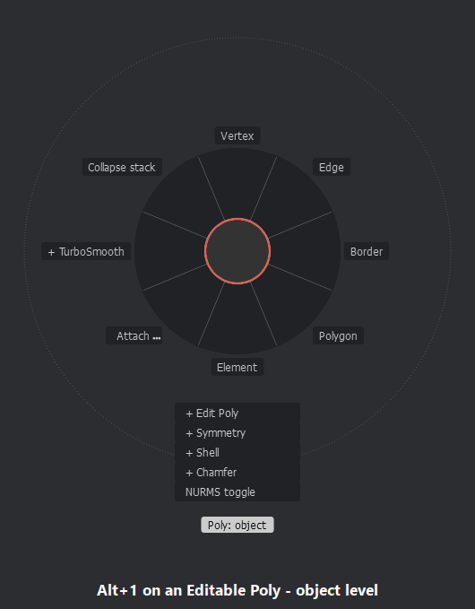

MarkingForge brings marking menus - the radial menus Maya users know - to 3ds Max.
Hold a key and a dial of eight commands appears around the cursor; move towards one
and release. Once your hand knows a direction, a quick flick runs the command
without the dial ever being drawn.

This repository holds the **documentation, release notes and the issue tracker**.
The plugin itself is sold separately; there is no source code here.

**Discord:** questions, tips and news with other users and the author - https://discord.gg/HsakZWQZAw

<!-- version:start -->
## Current version: 1.5.103

The latest changes ([all release notes](CHANGELOG.md)):

- [1.5.103 - Parameter wizard (beta) (2026-10-20)](CHANGELOG.md#15103---parameter-wizard-beta-2026-10-20)
- [1.5.102 - Chain submenus always on (2026-10-19)](CHANGELOG.md#15102---chain-submenus-always-on-2026-10-19)
- [1.5.101 - Instant over heavy objects (2026-10-19)](CHANGELOG.md#15101---instant-over-heavy-objects-2026-10-19)
- [1.5.100 - Submenus five levels deep (2026-10-19)](CHANGELOG.md#15100---submenus-five-levels-deep-2026-10-19)
- [1.5.99 - Chain submenus per menu (2026-10-19)](CHANGELOG.md#1599---chain-submenus-per-menu-2026-10-19)
<!-- version:end -->

<!-- whatsnew:start -->
## What's new

- **Parameter wizard (beta)** - put Box or Cylinder sizes, TurboSmooth iterations or the field of view on a direction with no MAXScript - drag for the number, release to apply. It changes the selected object, never the one under the cursor.
- **Instant over heavy objects** - with the menu under the cursor on, a dial over a mesh of millions of faces waited for 3ds Max to find the object - 280 ms on every press. Now a few milliseconds, even right after you edit the mesh, and a quick press is never lost.
- **Chain submenus, the Maya and PieMaster way** - a submenu opens right under the cursor and leaves a small circle behind - slide back onto it to go up, however deep you went. Always on; a menu can still open its submenus in place (the editor's Chain submenus row).
- **Deeper menus** - submenus can go four levels under a dial.
- **Editable Mesh on the Modelling dial** - vertex, edge, face, polygon and element tools - Extrude, Bevel, Chamfer, Weld and more - in the same directions as on Editable Poly.
- **Windows never waits for 3ds Max** - while a dial is held, typing and clicking in other programs stay instant, however busy 3ds Max is.
- **Multiple picks run from the centre** - queue several commands, come back to the middle and let go - all of them run.
- **Keeps up with heavy scenes** - a held dial no longer lags over a dense mesh in sub-object mode, and on a 120-180 Hz screen it draws as often as the screen can show.

Before you buy: the [FAQ](FAQ.md) answers the usual questions - versions, safety, licence, uninstalling.
<!-- whatsnew:end -->

## Highlights

- 24 ready-made dials on **Alt / Ctrl+Alt / Shift+Alt + 1-8** - modelling first (Alt+1..4: Modelling, Modifiers, Selection, Create; the viewport and the hotbox on Alt+5), the rarely used dials furthest away
- **Context-aware**: vertex, edge, border, polygon or element tools depending on the
  sub-object level - the same layout on Editable Poly and Edit Poly
- **The viewport on one key** (Alt+5): shading, lighting, display and views, a page each under
  the mouse wheel - every switch on a direction or in the list under the dial
- **Hotbox** with every 3ds Max menu, including other plugins' menus - one wheel notch away on Alt+5
- **Live dials**: modifier stack, undo by name, recent commands, selection sets
- **Menu editor** for 4000+ 3ds Max commands, your own scripts, sliders, colours,
  keyboard shortcuts and mouse buttons - with a live drawing of the dial, a new-dial
  wizard and ready-made context variants
- **Script library** - 102 ready-made scripts for modelling and everyday work (edge loops
  and rings, chamfer, bridge, bevel, symmetrize, greeble, unwrap, scatter onto a surface,
  arrange and stack, three-point lights, layers by type...), each one tested in 3ds Max
  - onto a dial in one click
- **Submenus** - a whole dial behind one direction (Create: Shapes, Primitives, Helpers,
  Cameras and lights; Modifiers: Deform, Geometry)
- **Sets** - several named contents on one dial (Modelling, UV, Retopo...): pages you
  turn with the mouse wheel while the dial is open, tabs in the editor, and a switch
  from the dial itself or with a key
- **Dial library** - every dial as a file of its own: restore an original in one click,
  or add one of 12 extra dials (mesh cleanup, retopology, pivots, cloning, smoothing,
  quick look, rigging, archviz, viewport views, lighting and display, the hotbox) and the
  preset packs' dials
- **Run at once, or open the settings with a longer move** - Chamfer, Inset, Extrude... run
  at once when you release near the dial and open their settings past the dotted ring
  (the other way round with one tick box, or per command); a flick follows the same ring,
  and how far out it lies is yours to set
- **Your size** - every dial from 60 to 160 %, the text from 70 to 200 %, and the green return ring of several picks in one gesture, set in the editor with a picture of the real dial
- **Opens in 100 ms** - a held key with the mouse still gets its dial after 100 ms, not after 3ds Max's own 250 ms (0 to 250 ms in *Dial speed...*, with an optional opening animation); a flick still draws nothing, a quick tap is still a tap
- **Maya's look** - one tick (*Experimental features > Maya marking menu look*) or one preset draws the dial as Maya's marking menu: grey boxes round a centre dot and a line to the cursor, no disc, and Maya's option boxes - release on the small square to open a command's settings. The shape travels with a saved look or a `.mfcolors` file
- **No settings windows** if you never want them - one tick and Chamfer, Inset, Extrude... always run at once
- Keyboard shortcuts ready from the first start, however it was installed
- Presets and four ready packs (Modelling, Animation, Look-dev, Archviz)
- Native C++ - about 3 ms to the first pixel. No internet connection, no telemetry

| | |
|---|---|
| 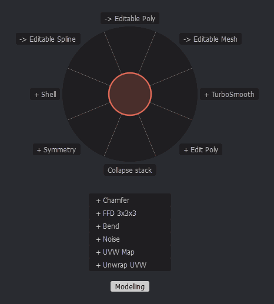 | 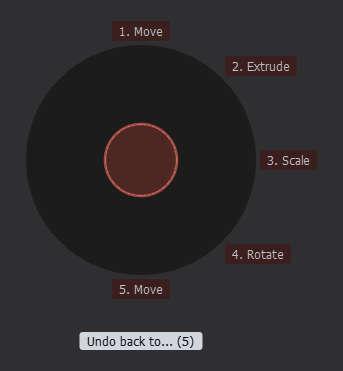 |
| 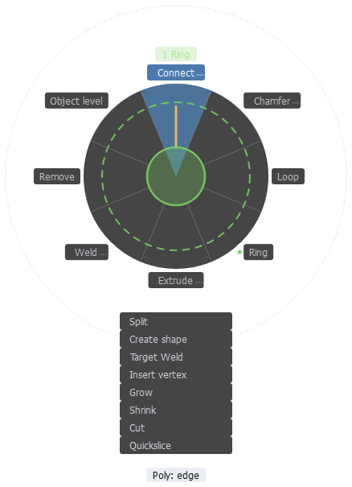 | 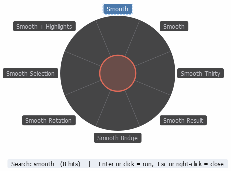 |
| 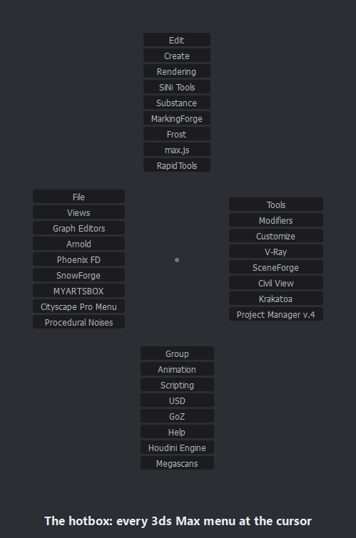 | 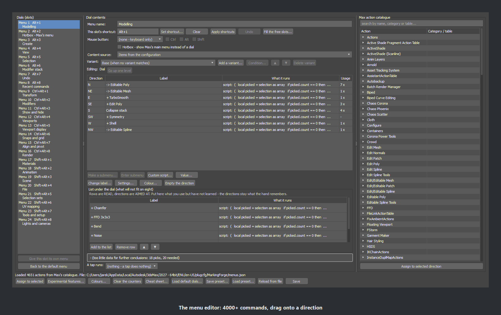 |
| 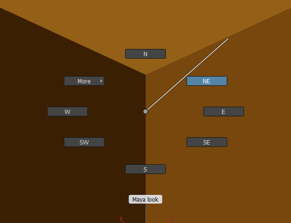 | 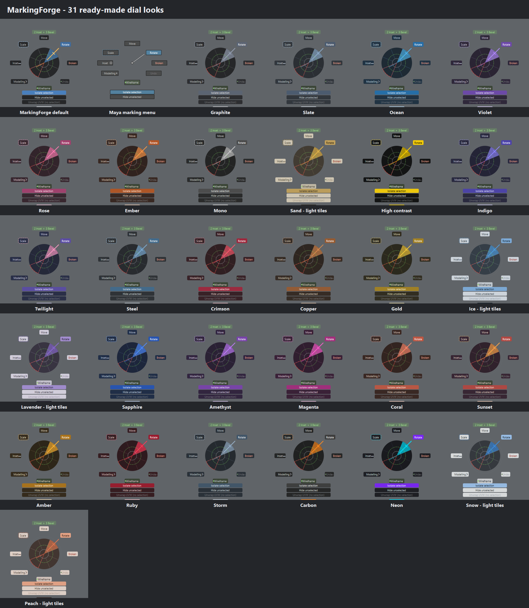 |

### The launch film

Everything in 93 seconds, recorded in 3ds Max 2027: three flicks for Inset, Extrude and Bevel, the ready-made
dials, context variants per sub-object level, several picks in one gesture with one undo, the settings ring,
a value dial, pages and the hotbox, type-to-search and the visual editor.
[Watch the film (MP4, 93 s, 1920x1080)](images/MarkingForge_Launch_93s.mp4).

### In use

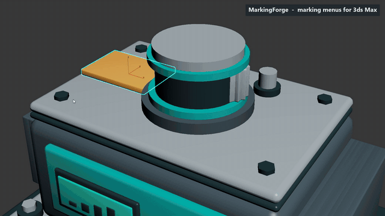

Real key and mouse input in 3ds Max 2027: a dial of your own (Inset, Extrude, Bevel, TurboSmooth),
Modifiers > Chamfer, the live modifier-stack and recent-commands dials, a Field of view slider, two
flicks without the dial, and the pages of Alt+5 ending in the hotbox.
[The full video (MP4, 44 s, 1920x1080)](images/MarkingForge_in_use_44s.mp4).

### The menu editor

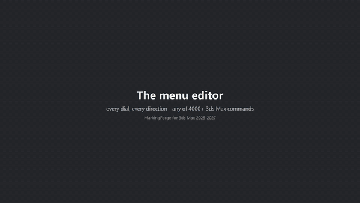

A dial named, commands found and assigned, a library script, a slider, the list under the dial, a
context variant, colours and the settings ring - then Save, and the dial as the plugin draws it.
[The full video (MP4, 64 s, 1920x1080)](images/MarkingForge_editor_64s.mp4).

### The script library

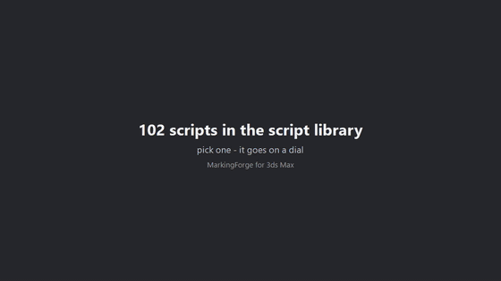

The script library window, then ten of its scripts run from a dial: before, the dial
aimed at the script, after. [The full video (MP4, 48 s, 1280x720)](images/MarkingForge_script_library_48s.mp4).

## Documentation

| Document | What it covers |
|---|---|
| [QuickStart Short](docs/MarkingForge_QuickStart_Short_v3.pdf) | 16 lessons and the tips, about 15 minutes - the quickest start |
| [QuickStart Long](docs/MarkingForge_QuickStart_Long.pdf) | all 22 lessons in plain words, every step in detail |
| [Editor Guide](docs/MarkingForge_Editor_Guide.pdf) | your first dial and every part of the menu editor, step by step |
| [Installation and Configuration Guide](docs/MarkingForge_Installation_Guide.pdf) | installing, updating, shortcuts, the 24 dials |
| [Reference](docs/MarkingForge_Reference.pdf) | every option, gesture and command; tips; problems and solutions |
| [Shortcut Card](docs/MarkingForge_Shortcut_Card.pdf) | the 24 dials on one printable page |
| [For Maya Users](docs/MarkingForge_for_Maya_Users.pdf) | Maya habits mapped to MarkingForge |
| [Preset Packs](docs/MarkingForge_Preset_Packs.pdf) | the four ready-made dial sets |
| [Studio Deployment Guide](docs/MarkingForge_Studio_Deployment.pdf) | silent installation for studios |

Release notes: [CHANGELOG.md](CHANGELOG.md)

## Requirements

Autodesk 3ds Max 2025, 2026 or 2027, Windows 10/11 64-bit. Each 3ds Max version has its own
download; 3ds Max 2024 and earlier may follow if enough users ask for them.

## Reporting a bug or asking for a feature

**[Open an issue](https://github.com/Forge-Plugins/MarkingForge/issues/new/choose)** and pick a form:

- **Bug report** - something does not work as described.
  In 3ds Max choose **MarkingForge > Report a bug...** first: it copies your 3ds Max and
  MarkingForge details to the clipboard, ready to paste into the form.
- **Feature request** - an idea for a new dial, command or option.
- **Question** - how do I...?

Prefer e-mail? Write to **forgeplugins@gmail.com** - the same address takes bug reports, feature
requests and support questions. Please do not post licence or purchase details in a
public issue; send those by e-mail.

**Roadmap** - what is planned and in progress: https://trello.com/b/7gJVqG8Y/markingforge-features-roadmap
(also MarkingForge > Roadmap (Trello) in 3ds Max).

**Discord** - questions, tips and news: https://discord.gg/HsakZWQZAw
(also MarkingForge > Discord community in 3ds Max).

## Author

More plugins by the author: https://forgeplugins.tech

MarkingForge and its documentation are (c) the author, all rights reserved.
Autodesk and 3ds Max are registered trademarks of Autodesk, Inc. MarkingForge is not
affiliated with or endorsed by Autodesk.
